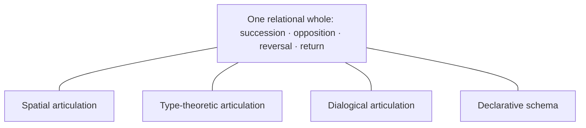

# Internal relations of the components

## The whole

W is one complete, inhabited twelve-position cycle. There is no distinguished
numerical origin in its primary specification. A frame can be centered at any
position; the relationships make the positions intelligible.

## Fourfold–three-mode articulation

Every position is one conjunction of the two differentiations. Each of the four
classes participates through three modes; each mode spans four classes. The
intersection is unique and exhaustive. A component's role is therefore a place
in the arrangement, not an independently grounded identity.

## Succession

Succession is adjacency within the full circuit. Its powers express relative
places. They need not be read as a time series, execution trace or causal chain.
It articulates the two differentiations together, (a,b) ↦ (a+1,b+1).

## Opposition

Opposition retains the three-mode determination and complements the fourfold
determination. Each pole belongs through the other; applying the relation twice
restores the same position. No position is its own opposite.

## Reversal

Reversal exchanges orientations, retains opposition and belongs to the same
whole. Each axis articulates an involution. It is not destruction of one
arrangement and construction of another.

## Return

Return is closure of the complete differentiation. Twelve is the least positive
joint return of its fourfold and three-mode determinations. Closure makes the
whole's differentiation complete without remainder.

## Co-presence

Spatial arrangement, formal identities, dialogical organization and declarative
schemas articulate the same relational signature in their own media. None is
assigned a causal priority or made the product of a code-level translation
from another. The formal co-presence statement concerns manifestations equipped
with these relationships; it does not supply an unstated reading of a particular
text. Their structural unity is the common organization itself.

## Co-present file articulation

The lines below express belonging, not direction of production.

